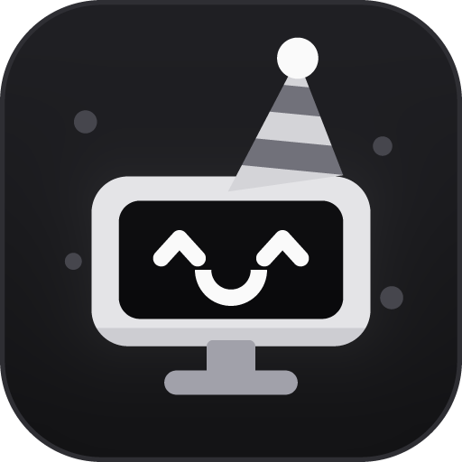
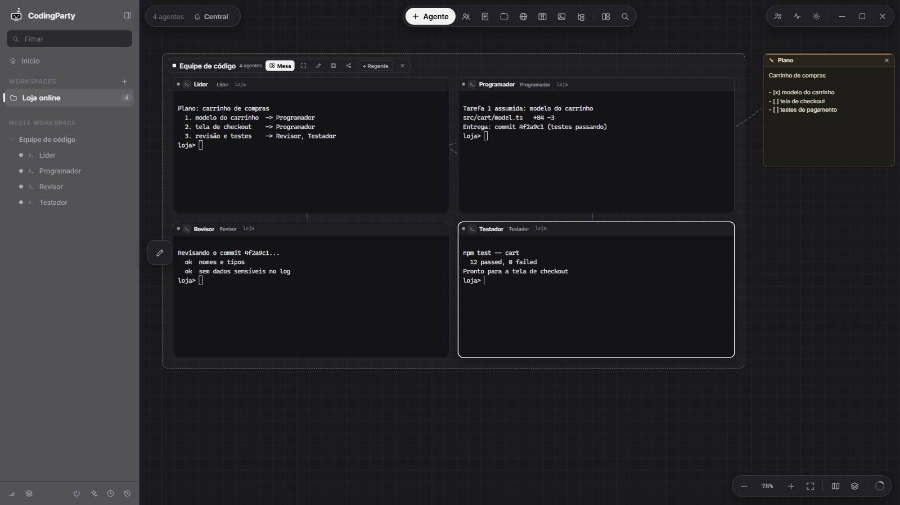
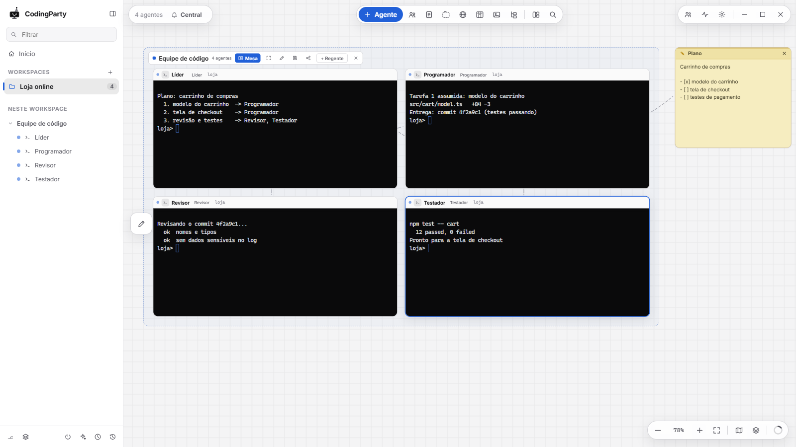

# CodingParty

**Sua equipe de agentes de IA, toda junta num canvas.**

[**Baixar para Windows**](https://github.com/barneybots/SpacePart-releases/releases/latest) · [O que mudou](https://github.com/barneybots/SpacePart-releases/releases) · [lowrender.xyz](https://lowrender.xyz)

O CodingParty coloca vários agentes de IA de programação lado a lado, cada um no seu terminal, num canvas infinito.
Ligue os terminais e eles conversam entre si, dividem tarefas e entregam o trabalho para você revisar.

Funciona com **Claude Code, Codex, OpenCode, Kilo, Qwen Code, Kimi Code, Pi, Grok Build, Antigravity, Freebuff e ZCode**,
além de qualquer shell (PowerShell, Git Bash, WSL, SSH e Docker).

## O que ele faz

- **Equipes prontas:** líder, programador, revisor e testador já ligados, ou um plano feito pelo Cérebro, com
  responsável, dependências e critérios de aceite em cada tarefa.
- **Tarefas em paralelo:** as independentes rodam juntas; as dependentes recebem o resumo das anteriores. Dá para
  pausar, retomar, cancelar ou trocar o agente de uma tarefa.
- **Entregas que você confere:** cada entrega de código fica ligada ao commit, com o diff, o teste do projeto numa
  cópia limpa e a sua aprovação.
- **Andares:** cada tarefa pode trabalhar numa cópia isolada do projeto (git worktree). No fim, o app combina os
  commits aprovados, testa e integra na branch.
- **Central de trabalho:** o que espera você, o que travou e o que terminou, de todos os projetos, numa fila só.
- **Avisos na hora certa:** você sabe quando um agente está trabalhando, esperando você ou terminou, com notificação,
  som e a barra de tarefas piscando.
- **Celular:** acompanhe e responda os agentes pelo navegador do celular, na sua rede.
- **Tema claro e escuro:** Grafite, Claro ou o do Windows, com a cor de destaque que você quiser.

## Instalar

| Arquivo | Para quem |
|---|---|
| `CodingParty-Setup-<versão>.exe` | A maioria das pessoas. Instala, cria o atalho e se atualiza sozinho. |
| `CodingParty-Portable-<versão>.exe` | Quem não quer instalar. Roda direto, mas não se atualiza sozinho. |

1. Baixe o instalador na [última versão](https://github.com/barneybots/SpacePart-releases/releases/latest).
   Funciona no **Windows 10 e 11 (64 bits)**.
2. **Aviso do Windows:** o instalador ainda não tem assinatura digital, então o Windows pode mostrar
   *"O Windows protegeu o computador"*. Clique em **Mais informações** e depois em **Executar assim mesmo**.
3. Siga o instalador. Quando sair uma versão nova, o app mostra o que mudou e atualiza com um clique.

## Primeiros passos

1. Na primeira abertura, **Primeiros passos** mostra quais agentes estão instalados. Instale pelo menos um (o botão
   **Instalar** cuida disso) e entre com a sua conta nele. Cada agente usa a conta e o plano da empresa dele.
2. Crie um workspace no **+** da barra lateral.
3. Clique em **Agente**, escolha o tipo e a pasta do projeto e escreva a tarefa. Para vários de uma vez, use
   **Equipe pronta**.
4. Ligue dois terminais arrastando de um para o outro: eles passam a trocar mensagens.
5. Aperte **F1** a qualquer momento para ver todos os atalhos.

## Perguntas frequentes

**Precisa pagar?**
O CodingParty é gratuito. Os agentes usam a sua conta em cada empresa (Anthropic, OpenAI, etc.), com o plano que você já tem.

**Ele usa a minha conta ou gasta o meu limite?**
O app não faz chamadas de IA por conta própria. Quem gasta limite são os agentes que você abre, como se você os
rodasse no terminal. Um painel mostra quanto do plano já foi usado.

**Por que o Windows avisa ao instalar?**
Porque o instalador ainda não tem certificado de assinatura digital. É seguro clicar em **Mais informações →
Executar assim mesmo**.

**Funciona no Mac ou no Linux?**
Por enquanto, só no Windows. Os agentes podem rodar no WSL, por SSH ou no Docker.

**Encontrei um problema. Como aviso?**
Em *Configurações → Sobre*, **Reportar problema** gera um relatório na Área de Trabalho. Confira o que tem dentro e
mande para [Barney'Dev](https://lowrender.xyz).

## Privacidade

O CodingParty não coleta nada: não tem conta, telemetria nem análise de uso. Workspaces, notas, logs e relatórios de
queda ficam no seu computador. O app só usa a internet para procurar versões novas dele e dos agentes, e para o que
você pedir (sites nos portais, instalar um agente ou baixar o gerador de imagens). Cada agente segue as regras de
privacidade da empresa dele. O acesso pelo celular vem desligado e só funciona na rede local.

---

Feito por **Barney'Dev** · [lowrender.xyz](https://lowrender.xyz)

O CodingParty se chamava SpacePart; por isso este repositório mantém o nome antigo. O app baixa as atualizações daqui.

